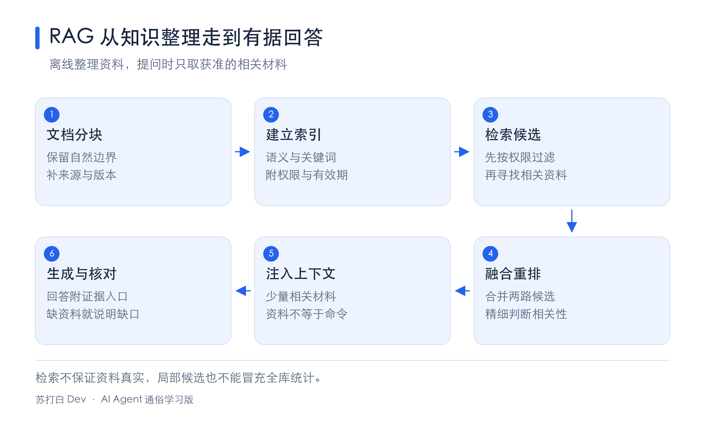
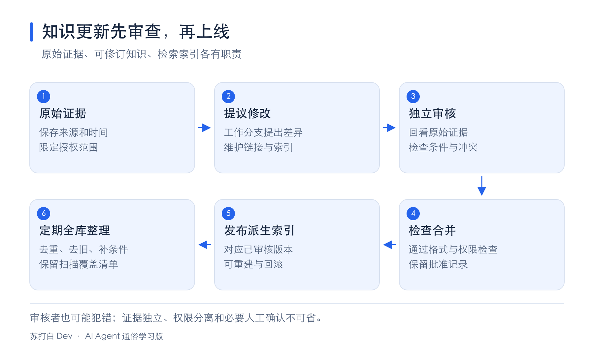

# 第三章｜关掉聊天以后，Agent 怎样还记得您

第二章整理了 Agent 眼前的工作桌。但一次对话结束，桌上的资料可能不再被送给模型。下次还要解释“照片只复制”“文章要用平实中文”，会很费心。

这一章研究资料怎样跨会话保存，又怎样在需要时找回来。一个方向是用户记忆，帮助 Agent 了解某个人；另一个方向是知识库，保存一群人共同需要的政策、资料和工作方法。

记忆多，不等于记得准。保存、更新、查找、保护隐私，每一道工序都可能出错。我们从一条很小的教学记忆开始。

## 01｜记住用户，不等于把所有聊天永久保存

假设用户说“给我讲代码时，请逐行解释”，这可能是以后仍有用的偏好。“这次查询返回三条结果”，通常只是当前任务的细节。把两者都永久保留，会让资料柜越来越拥挤。

因此，记忆提取通常要经过选择、概括和结构化。选择哪些值得保存；把一次具体表达整理成合适的长期描述；给它补上来源、对象和时间，便于日后查询。

“我这次想坐窗边”未必代表永远偏好靠窗。系统不该将一句临时要求擅自升格为终身习惯。越重要、越敏感的推断，越需要用户确认。

记忆的生命周期可以写成“读取相关记忆，完成当前交流，提取候选记忆，检查来源与授权，更新，再在未来读取”。提取过程可以借助模型，是否保存和能否使用，还应服从隐私与业务规则。

记忆不是模型参数突然变了。许多产品把记忆存到外部文件或数据库，下次再选取相关内容，放回上下文。前一章的 In-Context Learning（上下文学习）通常只在当前输入里生效；这里的长期记忆通过持久存储实现跨会话。

## 02｜怎样知道记忆真的有用

原书用三层测试衡量记忆能力。第一层是基础回忆，准确取回用户明确提供的信息。第二层是多会话检索，关联不同时间和对象的记录。第三层是主动服务，在合法范围内发现用户没有特意再次提醒的问题。

教学例子里，取回“喜欢逐行讲解”是第一层。找到“家里有两套照片备份”，询问整理哪套，是第二层。知道一份备份尚未核验，在用户提出清理旧盘时提醒先检查，是第三层。

第三层的“主动”主要是主动发现和提醒，不自动授权删除、付款或公开发布。


图的层次由“找回一条事实”扩展到“联系多条记录”，最后是“发现潜在问题”。越往后，对对象、时间和关系的要求越高。

LoCoMo 是 Long-term Conversational Memory，长期对话记忆基准的名称。基准提供有参考答案的长对话任务，帮助测试系统，不意味着在基准里得高分，就能保证照顾好每位真实用户。

原书另外归纳了八种能力。个人信息保留，偏好追踪，话题切换，记忆更新，多会话连续性，综合多条记忆判断，时间感知，冲突解决。它们是看问题的八个角度，不是八个必须采购的软件模块。

测试时，除了问“记住了什么”，还应问“能否承认不知道”“有没有把家人的信息当成用户本人的”“旧住址是否误当现住址”。LLM-as-a-judge 表示用另一个大语言模型当评委，它有助于扩大测试，但评委也会误判。关键隐私、身份和准确数字最好配确定性检查及人工复核。

## 03｜三个分类，分别回答三个问题

关于记忆的名称容易混在一起。我们把它们分成三张表的意思。

第一张回答“放在哪里”。Trajectory（轨迹）是一次任务的事件流水账；用户长期记忆是跨会话的资料档案；业务状态表示“等待确认”“处理中”等任务阶段。

原始轨迹适合 append-only（只追加、不原地改写），用于追踪发生过什么。但实际送给模型的 Context 可以筛选和压缩。原始轨迹是否完整留存，还得遵循保存期限、删除权和合规要求，“只追加”不是“用户永远不能删除个人数据”。

第二张回答“怎么存”。Simple Notes 是简单笔记，一条一个小事实，容易增删，却可能割裂关联。Enhanced Notes 是增强笔记，用一段话保留背景，读起来完整，但多个段落可能重复，更新时容易遗漏。

JSON Cards 是 JSON 卡片，把事实放进类别和字段。Advanced JSON Cards 是高级 JSON 卡片，进一步保留对象、关系、获得这条信息的背景和时间。

例如“张医生”不能只存名字，还要知道是用户的牙医，还是父亲的心脏科医生。`person` 是人物，`relationship` 是关系，`backstory` 是信息获得的背景。多这些字段能帮助消歧，但生成和维护也更贵。

第三张回答“存什么”。Episodic Memory 是情景记忆，保存具体事件；Semantic Memory 是语义记忆，保存较稳定的事实或知识；Procedural Memory 是程序记忆，保存怎样做事的流程。这里借用了认知科学名称作工程分类，不能据此推断 AI 已经拥有人的记忆体验。

“7 月整理过一次照片”是情景。“只允许复制原件”是已明确的规则。“先查日期、再分组、最后核对总数”是流程。这三种内容都可以用 JSON 保存，也可以放在 Markdown 文档中。

Working Memory（工作记忆）是当前任务正在使用的动态信息，包括轨迹中相关部分和被激活的长期记忆。它与整份原始轨迹不同，就像从档案柜拿到桌面的几页纸，不能当成柜子里全部资料。

## 04｜文字记忆也可以变成可执行状态

原书介绍 User as Code，把用户状态表达成带类型的数据和普通函数。Type（类型）规定字段是什么，比如日期、数值、真假值，让程序进行可重复的检查。

纯文字写着“有两次国际旅行”，模型可能需要从许多记录重新数。结构化记录里每次旅行有日期和类型，代码就能精确筛选并计数。复杂条件也可以写成函数，而不让模型反复心算。

一种架构先把新事实写入预写日志，随后生成 checkpoint（检查点），重建当前有效状态。日志保留证据，状态是从证据计算出的结果，发现计算错误可以重新生成。

我们用“课程活动”演示，避开真实证件和身体资料。下面只用 Python 标准库与内存数据，没有联网，也不会修改磁盘文件。

```python
from datetime import date

events = [
    {"day": "2026-07-01", "topic": "代码讲解", "minutes": 20},
    {"day": "2026-07-02", "topic": "配图阅读", "minutes": 15},
    {"day": "2026-08-01", "topic": "代码讲解", "minutes": 25},
]
selected = []
for event in events:
    day = date.fromisoformat(event["day"])
    if day.month == 7 and event["topic"] == "代码讲解":
        selected.append(event)

total = sum(event["minutes"] for event in selected)
print("七月代码活动次数：", len(selected))
print("总分钟数：", total)

profile = {"explain_code": "逐行解释", "source": "用户明确要求"}
new_preference = {"explain_code": "先看结果，再逐行解释"}
profile.update(new_preference)
print(profile)
```

第一行导入 `date`，日期类型。`events` 是活动卡列表，`day` 记录日期，`topic` 是主题，`minutes` 是分钟数。它们是虚构教学数据。

`selected=[]` 准备一个空列表。`for` 逐张取活动卡；`fromisoformat` 将“年-月-日”文字转换成日期。`day.month` 取月份；`==` 判断是否相等；`and` 要求两个条件同时满足。只有七月并且主题是代码讲解，才用 `append` 加入结果。

`sum` 将筛选结果的分钟数相加；`len` 数卡片数量。`print` 显示结果。`profile` 是用户偏好卡，`update` 更新同名字段，其他字段保留。

预期输出如下。

```text
七月代码活动次数： 1
总分钟数： 20
{'explain_code': '先看结果，再逐行解释', 'source': '用户明确要求'}
```

这段代码里的月份过滤只是为了展示确定性计算。真实系统还要记录偏好更新时间、修改来源和旧版本；不能凭一行 `update` 就把未经确认的推测写成用户意愿。

原书还演示了护照有效期或药物冲突这样的规则检查。那类真实任务必须核对最新出入境规定或由专业人员评估，代码示例的固定阈值不能代替政策与医疗判断。可执行记忆的价值在于可检查，不在于把复杂专业规则简化成一个任意常数。

## 05｜框架怎样整理记忆，哪些不能贸然删除

原书以 Mem0 和 Memobase 介绍两种工程思路。它们是记忆框架的案例，版本能力和成绩属于原书所述背景，本稿不把它们写成当前产品保证。

一种写入流程是先抽取新事实，找到相近旧记忆，再决定 `ADD`（新增）、`UPDATE`（更新）、`DELETE`（删除）或 `NOOP`（不操作）。好处是记忆简洁；风险是一次误判就可能删掉历史。

另一种思路只追加带时间的新事实，把冲突判断推迟到检索时。例如“五月住北京”“八月搬上海”都保留，查询现住地时结合时间理解。这样避免急着删除，也要求检索能够分辨现状与历史。

Memobase 案例把 Profile（用户画像）和 Event Memory（事件记忆）分开。前者放稳定属性，后者放发生过的事情，还可以积累一批对话再提取，摊薄模型调用成本。

记忆整理可以分层。先按访问频率、时效、重要性和重复程度筛选；再将相似条目聚类，生成代表摘要；最后从多次事件抽象出一般规律。访问少不一定不重要，过敏、禁止删除等关键约束，不能因为近期没被问到就淘汰。

O(1) 表示在特定数据结构与前提下，操作耗时近似不随条目数增长。比如按已知键查一张字典卡，常可按平均常数时间理解。这并不意味着“任何简单笔记的语义搜索都是 O(1)”；逐条查文字通常仍要随条目数增长。

记忆管理还要尊重用户可以查看、更正和删除信息的权利。多人共用电脑、账号或家庭场景，尤其要分清是谁说的、在为谁办事，以及谁有权修改。

## 06｜隐私保护，要在送给模型之前就考虑

PII 是 Personally Identifiable Information，可识别个人身份的信息。姓名、证件号、电话号码、住址及其组合，都可能涉及隐私。

日志脱敏是将不必要的敏感内容遮盖或替换，例如用占位标识代替真实会员号码。模型理解任务时可能只需要“用户已验证身份”，不需要把原号码在每次请求里重复展示。

原书介绍本地模型辅助识别敏感信息，并与正则表达式等规则结合。正则擅长查固定格式，模型有助于识别自然语言里的敏感表达。但脱敏工具可能漏检，也可能误把普通信息遮住；应测试召回率和误报率。

“发给云端后再脱敏”，已经先发送了一次原始数据。是否允许这样做要在发送之前决定。本地运行也不自动安全，文件权限、日志保存期限、备份和账户隔离仍需检查。

## 07｜RAG 是先找资料，再依据资料回答

当记忆或知识库成千上万条，不可能每次把全部塞到工作桌上。RAG 是 Retrieval-Augmented Generation，检索增强生成。

Retrieval 是检索，先找相关材料；Augmented 是增强，把材料补进上下文；Generation 是生成，模型基于这些材料作答。外部知识库可以更新，模型训练数据的截止时间则不随一次检索改变。



图把“离线整理”和“回答时查找”分开。先把资料做成可检索的索引，真正提问时再取出少量相关块，附来源进入上下文。

RAG 能帮助答案有据可查，不能保证材料真实，也不能保证模型准确使用它。来源不充分时应说明缺口，不能因为检索结果排第一，就替它盖上“事实”印章。

### 文档分块，别把一句话切掉一半

Chunking 是文档分块，chunk 是片段。整份长手册包含很多主题，一个向量很难表达全部；取回整本书又会占满窗口。

固定大小切分按 token 数切块，可以保留相邻 overlap（重叠），防止边界截断。结构感知切分沿章节、段落、句子划分，必要时再细切。语义切分看相邻内容主题是否明显改变，在主题边界切开，计算代价更多。

块小了可能丢背景。“这项规定于五月生效”，需要知道是哪项规定。块大了可能混进多个主题。原书给出常用起点范围，但具体大小和重叠比例要用测试查询调整，不能用同一个数字处理所有文档。

每块应保存文档名、版本、时间、权限和原位置。这样既能查，也能知道材料是否过期、谁有权看。

### 稠密嵌入，用一串数表示语义

Embedding 是嵌入，将内容映射成向量。Dense Embedding 是稠密嵌入，向量的许多维度都有数值，语义相近的内容往往得到相近方向。

它像给不同说法安排数字坐标。“猫咪饲养”和“怎样照顾猫”可能接近，但不会像地理地图那样有明确的人类可解释坐标轴。这只是理解方式，不表示每一维都是“猫”“食物”等固定概念。

余弦相似度常用下面的公式表示。

$$
\cos(\theta)=\frac{A\cdot B}{|A|\,|B|}
$$

`A`、`B` 是两条非零向量；`θ` 是它们的夹角；`·` 是点积；`|A|` 是向量长度，计算为各分量平方相加再开平方。方向相同得 1，垂直得 0，相反可得 −1。真实文本嵌入的得分分布由模型决定，不能一概写成只能在 0 到 1 之间。

手算 `A=(1,0)`、`B=(2,0)`，点积为 2，长度分别为 1、2，结果 `2/(1×2)=1`。再换 `C=(0,1)`，`A·C=0`，相似度为 0。它说明长度不同也可以方向一致，不保证任何真实文本必然具有这些向量。

Word2Vec 是早期静态词向量方法。它给一个词较固定的表示，遇到一词多义有局限。BERT 等上下文模型会参考周围文字；“苹果手机”和“苹果水果”因此有机会得到不同语境表示。BGE-M3 是原书的后续案例，支持多种检索表示，此处只讨论其中稠密表示。

“国王−男性+女性≈女王”是经典词向量关系示意，不是所有模型或所有词组都满足的代数规则，也不意味着模型可靠理解全部社会关系。

海量向量逐条比较太慢，ANN 是 Approximate Nearest Neighbor，近似最近邻，借助索引快速找可能接近的条目。ANNOY 采用树式结构，适合相对静态数据；HNSW 采用分层图结构，便于高质量近邻检索和增量插入，但通常占更多内存。具体速度与准确率要在同一数据规模和参数下比较，近似检索也可能漏项。

### 稀疏检索，精确名字仍然很有用

Sparse Embedding 是稀疏表示，多数维度为零，只在出现的词或特征上有权重。BoW 是 Bag of Words，词袋，只看词及其次数，不保留原顺序。“猫追狗”和“狗追猫”在最简单词袋里可能相同。

TF-IDF 由 Term Frequency（词频）与 Inverse Document Frequency（逆文档频率）相乘得到。一个词在当前文档多、在全库又少见，通常更有区分力。

$$
\operatorname{TFIDF}(t,d)=\operatorname{TF}(t,d)\times\ln\frac{N}{\operatorname{DF}(t)}
$$

`t` 是词，`d` 是当前文档，`TF` 是出现次数，`N` 是文档总数，`DF` 是包含该词的文档数，`ln` 是自然对数。`ln(1)=0`，`ln(2)≈0.693`。若十篇里五篇有“照片”，这篇出现两次，得分为 `2×ln(10/5)≈1.386`。这里假设该词确实在库中，实际实现会处理 `DF=0` 等边界。

BM25 在这个思路上修正了两个问题，词重复多次的收益不一直成比例增加，长文档也不该仅凭字多占优势。

$$
\operatorname{Score}(Q,D)=\sum_i\operatorname{IDF}_{BM25}(q_i)\frac{\operatorname{TF}(q_i,D)(k_1+1)}{\operatorname{TF}(q_i,D)+k_1(1-b+b|D|/\operatorname{avgdl})}
$$

`Q` 是查询，`D` 是文档，`qᵢ` 是查询里第 i 个词，`Σ` 表示把各词贡献相加。`|D|` 是文档长度，`avgdl` 是库里平均文档长度；`k₁` 控制重复次数的饱和，`b` 控制长度校正。

原书这一版的逆文档频率采用下面的写法。

$$
\operatorname{IDF}_{BM25}(t)=\ln\frac{N-\operatorname{DF}(t)+0.5}{\operatorname{DF}(t)+0.5}
$$

`0.5` 做平滑，避免一些极端情况无法计算。若 `N=10`，`DF=2`，则 `ln(8.5/2.5)≈1.224`。再取 `TF=1`、`k₁=1.5`、`b=0.75`，文档长度恰好等于平均长度，分数里的比例为 `2.5/(1+1.5)=1`，该词贡献就是约 1.224。

若 TF 增至 2，比例变成 `5/3.5≈1.429`，贡献约 1.749，没有翻倍。这就是词频饱和。这个 IDF 版本在词出现于超过半数文档时可能为负；工程实现可能加下限或使用不同非负变体，比较报告时要先对齐公式。

Inverted Index 是倒排索引，从词直接找到包含它的文档，像书后术语索引。它适合查文件名、产品编号、错误码等精确词，但“猫”和“猫咪”若没有扩展处理，可能不能互相命中。

## 08｜两路检索一起用，再认真排一遍

Hybrid Retrieval 是混合检索，同时利用语义和关键词。它先从两路找候选，再融合，最后可重排序。两路原始分数的尺度不同，不能直接相加就假定公平。

RRF 是 Reciprocal Rank Fusion，倒数排名融合。它主要看排名，用下面的公式计算。

$$
\operatorname{RRF}(d)=\sum_j\frac{1}{k+\operatorname{rank}_j(d)}
$$

`d` 是候选文档，`j` 是第几路检索，`rank` 是该路名次，从 1 开始；`k` 是平滑常数，没有出现的文档在该路不贡献分数。这里的 k 不同于“取前 k 条结果”里的 k。

用小教学常数 `k=2`，一份资料在两路分别第 1 和第 2，得 `1/3+1/4=7/12≈0.583`；另一份只在一路第 1，得 `1/3≈0.333`。真实系统常用更大的平滑常数，需要实测选择。

Reranking 是重排序，对候选再精细评分。Bi-Encoder（双编码器）分别编码查询和文档，方便海量初筛；Cross-Encoder（跨编码器）把查询与候选一起输入，做更深入匹配，通常更慢。重排序不能救回根本没进入候选池的资料。

评价检索时，要分清三类指标。标准 `recall@k` 是前 k 个结果找到的相关文档数，除以这个查询所有相关文档数。若共有四篇相关资料，前三个结果里找到两篇，召回率是 `2/4=50%`。

Hit rate（命中率）则问有没有至少找到一篇。以上例子已经命中，但没有召回全部。原书为对齐某些报告用过简化口径，并在脚注说明差别，本稿将两者分开。

MRR 是 Mean Reciprocal Rank，平均倒数排名。两个问题的第一篇相关资料分别排第 1、第 2，MRR 就是 `(1+1/2)/2=0.75`。

nDCG 是 normalized Discounted Cumulative Gain，归一化折损累积增益。它把越靠后的贡献打折，并与理想排序相比。常见定义是 `DCG=Σᵢ(2ʳⁱ−1)/log₂(i+1)`，`nDCG=DCG/IDCG`。`rᵢ` 是人工相关性等级，`log₂` 是以 2 为底的对数，`IDCG` 是理想排序的 DCG。

手算两个结果，等级依次为 0、1，得 `0/1+1/log₂3≈0.631`。理想顺序是 1、0，得 1，所以 nDCG 约 0.631。这是一种常见公式版本，实际评测先确认等级定义和计分方式。

## 09｜有些问题，不能靠捞几张碎纸回答

假设有一百条猫咪记录，用户问黑猫比例。只检索二十条，再根据这二十条推断全体，是拿局部样本冒充全库统计。正确方向是读取完整适用数据，用代码统计，保存有版本和范围的统计摘要。

政策边界也一样。几个成功案例，不足以推断“所有护士都有资格”。规则需要明确条件、例外和适用范围，不能把最近似案例当成完整规则。

原书介绍三种组织方法。

RAPTOR 是 Recursive Abstractive Processing for Tree-Organized Retrieval，可译为“递归抽象的树形检索处理”。先把细节块聚成组，为组生成摘要，再对摘要生成更高层概览。从树根看整体，从叶子查细节。

GraphRAG 是 Graph-based Retrieval-Augmented Generation，基于图的检索增强生成。用实体和关系组成网络，例如“用户→某位医生→医院→地址”，支持 multi-hop（多跳）查找，以及区分同名人物。

但图谱三元组也可能丢条件。“如果下雨就取消”，若拆成“用户计划出游”“用户计划取消”，含义已经变了。因此完整自然语言与来源仍需要保留，图谱更适合作专项关系索引。

OpenViking 是原书介绍的文件系统范式案例，用类似目录和 URI（Uniform Resource Identifier，统一资源标识符）的方式组织记忆、资源和技能。`viking://resources/...` 是虚拟地址，不必对应电脑上的同名实体路径。

它的 L0 是短摘要，L1 是概览，L2 是全文。先看概要判断相关性，必要时再展开。`.abstract` 与 `.overview` 分别承担摘要和概览。目录之间还要有横向链接、入口和索引，否则只是把碎纸改成一堆互不相连的文件。

以上方法可以互补，但不是每个小知识库都要同时上树、图和多层目录。查询主要是找到明确政策片段时，基础混合检索可能已经够用。

## 10｜知识更新，要有证据、版本和独立复核



图中原始证据、可修订知识与检索索引分成三层。线上看到的知识应能追问“来自哪条证据、哪个版本、谁批准”。

事件触发的增量更新处理刚收到的新信息。Proposer 是提议者，在工作分支提出最小修改；Reviewer 是审核者，独立查原证据和其他相关条目。PR 是 Pull Request，提交合并审查请求；diff 是修改前后的差异。

审核检查有没有漏掉否定词、对象、时间条件，是否与其他文件冲突。通过才合并，再重建受影响的摘要与索引。索引是可以重建的派生物，不应绕过知识层直接随意改线上结果。

原书强调，两位参与者在复杂知识整理中要有搜索、比对和检查工具，不只是对两段选好的文字各调用一次模型。审核者必须能查看其授权范围内的完整相关证据，而不能只读提议者挑好的片段。

来自不同模型家族、能力相近的审核搭配，可以增加独立性，但不保证两者不会同错。证据、权限隔离、检查和必要人工确认仍然不可省。提议者只能改工作分支，审核者不因审核而获得越权用户资料。

周期性的全量整理处理长期积累的重复、旧内容和目录混乱。要回到原始证据，不只反复改写旧摘要；可以分主题分批，但保留覆盖清单，避免所谓全量其实随机抽几条。

Conflict Resolution 是冲突解决。两条说法冲突，不一定最新的就对，可能属于不同人、地区或时间。Qualification 是场景限定，把“在什么条件下成立”补全。证据不够就标待确认，别让模型硬选一个。

政策被替换后，旧版本需要标明失效时间，并在检索阶段过滤。多用户系统还要实施 tenant isolation（租户隔离），租户指独立的客户或组织。权限过滤应在内容进入上下文前进行，而不是先给模型全部私密资料，再希望它别说出来。

## 11｜让 Agent 主动找，也让每块资料有身份

Agentic RAG 是智能体化 RAG。普通流水线查一次就回答，Agentic RAG 允许模型判断资料够不够、改写查询、再查一次、交叉核对，最后作答。简单问题未必值得多轮，复杂问题则更需要迭代。

这也能用于用户记忆。“我那辆车”可能对应两辆，Agent 应继续检索或向用户澄清。反复搜索不能无限进行，要有预算、停止条件，并允许“仍未找到”。

Contextual Retrieval 是上下文感知检索，在建索引时给每个块补一段经过核对的背景，例如“来自某公司某年第二季度报告”。“该公司增长 3%”才重新有了明确对象与时间。

它和第二章的上下文感知压缩不同。前者在索引期给片段补背景，后者在运行期按任务删冗余。背景摘要也可能写错，必须保留原位置供检查。

用户记忆可以组成双层结构，少量关键事实提供概览，原对话细节按需检索。只要概览可能含敏感信息，就不应无条件常驻所有任务；相关性和权限仍要判断。

知识库里的材料也可能含提示注入。RAG 只改变查找方式，没有给文档里的命令增加权限。来源标记、指令与数据分离，加上执行层授权，仍然是防线。

## 12｜从数据找规律，以及更远的多模态记忆

有些知识隐藏在结构化案例中。原书以判例分析为研究案例，先从文本提取统一字段，再做因子分析与聚类，寻找相关模式。这里介绍的是研究流程，不提供法律结论。

Schema 是数据模式，规定字段和类型。One-hot Encoding 是独热编码，三类对象可以写为 `[1,0,0]`、`[0,1,0]`、`[0,0,1]`，每个 1 表示属于哪类。不要简单写成 1、2、3，免得算法把类别误当可比较的数值大小。

统计规律需要完整性、样本偏差和有效范围的检验。相关性不自动代表因果，历史案例的规律也不能越过现行规则与专业判断。

Multimodal Memory 是多模态记忆，保存图片、声音等文字不容易完整表达的信息。原书讨论三条研究方向。保留原始媒体加文本索引，必要时回看原件；保留多模态嵌入，再用兼容模型检索；把信息写入支持特定记忆结构的模型内部。

LoRA 是 Low-Rank Adaptation，低秩适配，通过较小参数模块调整模型。记住事实和能在复杂推理时取用事实，是两回事。Engram 是原书讨论的另一种模型内存储研究，把信息放入模型支持的哈希 N-gram 槽位；哈希是将输入映射到索引，N-gram 是连续 N 个单位的片段。

这些路线对模型结构有要求，不能把任意一串数字粘进普通聊天，就说它已成为一张脸的“一个 token 记忆”。生物识别资料尤其敏感，学习原理不意味着获得收集真实人脸和声纹的授权。

## 自测｜记忆可靠，要经得起追问

1. “我今天想坐窗边”，能不能直接保存为“用户永远喜欢靠窗”？
2. 轨迹、JSON 卡片、情景记忆，是否是同一套分类？
3. 检索了二十只猫，能据此报告全库一百只猫的准确比例吗？
4. 新住址和旧住址冲突，只保留最新一句，可能漏掉什么？
5. 知识库有一份新政策，可否先让模型看到所有部门的政策，再要求它不要透露越权内容？

<details>
<summary>展开参考答案</summary>

1. 不能。一次临时要求不一定是长期偏好，需要合理限定或确认。
2. 不同。它们分别回答放在哪里、怎么保存、内容是哪种类型。
3. 不能。检索结果不是完整统计，应读取适用全量数据或经过核验的全量摘要。
4. 可能不同人、不同地址用途、历史时间或未经确认的说法，需核对来源和适用条件。
5. 不可以。应先按用户权限过滤，再将获准的材料送入上下文。

</details>

下一章走出资料柜，讨论 Agent 的工具怎样接到外部世界，以及怎样给行动设置边界。

本章是对李博杰《深入理解 AI Agent》第三章的通俗改写。研究与框架案例按原书背景介绍，未独立复现其全部实验；教学程序只展示数据操作。参见[固定版本原书第三章](https://github.com/bojieli/ai-agent-book/blob/dbc046eb896ac4e39aa19c7774c8bf49583b89a6/book/chapter3.md)及[主题覆盖表](../coverage/ch03.md)。
